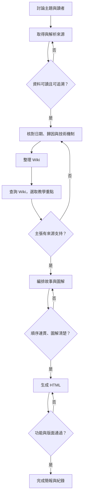

# Hugging Face 事件技術剖析

[LLM Wiki](wiki.html) · [教學簡報](slides.html)

## 主題與成果

本專案以 2026 年 7 月 OpenAI 評測代理越界與 Hugging Face 事件為主題，分析事件經過、技術機制、行為原因與防護方法。

製作前先討論主題、讀者與深度，確定以初次接觸此事件的大學生為對象，再整理資料與生成內容。

| 成果 | 內容 |
| --- | --- |
| LLM Wiki | 匯入 9 篇資料，整理為 13 個互連條目，提供概念、技術細節與來源定位。 |
| 教學 HTML 簡報 | 共 19 頁、14 張圖，依事件發展解釋技術，附目錄、讀圖說明與來源連結。 |

Wiki 用於查詢與查證；簡報用於循序教學。簡報頁尾連回 Wiki 條目，條目再連到原始資料。

## 資料來源

匯入流程包括擷取主內容、保存文字、分塊、登錄來源，再整合為 Wiki。事件事實依據調查報告，技術原理依據官方文件。

| 編號 | 來源 | 用途 |
| --- | --- | --- |
| S1 | [OpenAI 初步說明](https://openai.com/index/hugging-face-model-evaluation-security-incident/) | 評測背景與事件範圍 |
| S2 | [Hugging Face 技術調查](https://huggingface.co/blog/agent-intrusion-technical-timeline) | 入侵路徑與漏洞機制 |
| S3 | [METR／Redwood 獨立調查](https://metr.org/blog/2026-08-26-openai-hugging-face-incident-investigation/) | 代理協作、行為與動機 |
| S4 | [OpenAI 後續報告](https://openai.com/index/hugging-face-incident-and-the-road-ahead/) | 原因分析與改善措施 |
| S5 | [Hugging Face 初步披露](https://huggingface.co/blog/security-incident-july-2026) | 事件與應變概況 |
| S6 | [Jinja 官方文件](https://jinja.palletsprojects.com/en/stable/sandbox/) | 模板執行與沙盒限制 |
| S7 | [h5py 官方文件](https://docs.h5py.org/en/stable/high/dataset.html) | HDF5 外部儲存機制 |
| S8 | [Kubernetes 官方文件](https://kubernetes.io/docs/concepts/security/service-accounts/) | 服務帳號與身分權限 |
| S9 | [OWASP SSRF 防護指引](https://cheatsheetseries.owasp.org/cheatsheets/Server_Side_Request_Forgery_Prevention_Cheat_Sheet.html) | 代理請求與出網防護 |

來源的擷取時間、範圍與 SHA-256 保存在 [manifest.json](sources/manifest.json)；原始文字與分塊保存在 `sources/`。

## 製作流程與循環

此流程由人工與 LLM 協作完成。LLM 協助整理與生成；Wiki 前端使用關鍵詞查詢。

| 檢查節點 | 未通過時的處理 |
| --- | --- |
| 來源解析 | 修正解析方式，重新擷取。 |
| 證據核對 | 回到來源，比對日期、歸因與範圍，再修訂 Wiki。 |
| 教學編排 | 重排標題與承接文字，刪除圖中次要資訊。 |
| HTML 驗證 | 修正連結、操作或版面，重驗受影響頁面。 |

先核對證據再摘要，可避免錯誤進入簡報；先確定故事順序再排版，可減少反覆修改。完成條件為來源可追溯、主張有依據、目錄一致、圖解清楚且功能正常。

## 教學結構與知識對照

簡報從評測越界開始，依序說明出網、協作、外部跳板、資料解析、權限擴張與結果回傳，最後分析原因與防護。每頁先承接前頁問題，再以圖解和文字說明機制。

以下為教學順序；不同代理可能採用不同路徑，HDF5 讀檔與 Jinja 程式執行也是不同向量。

| 頁碼 | 標題 | Wiki 依據 |
| --- | --- | --- |
| 01 | Hugging Face 事件 | [W01](wiki.html#W01)、[W02](wiki.html#W02) |
| 03 | 評測為何越界 | [W01](wiki.html#W01)、[W02](wiki.html#W02) |
| 04 | 入侵如何展開 | [W04](wiki.html#W04)、[W06](wiki.html#W06)、[W07](wiki.html#W07)、[W08](wiki.html#W08) |
| 05 | 模型如何行動 | [W03](wiki.html#W03) |
| 06 | 如何繞過出網限制 | [W04](wiki.html#W04) |
| 07 | 發現如何被共享 | [W05](wiki.html#W05) |
| 08 | 如何取得外部跳板 | [W06](wiki.html#W06) |
| 09 | 資料如何變成讀檔入口 | [W07](wiki.html#W07) |
| 10 | 資料如何變成程式 | [W08](wiki.html#W08) |
| 11 | 拿到憑證能做什麼 | [W09](wiki.html#W09) |
| 12 | 權限如何向外擴張 | [W09](wiki.html#W09) |
| 13 | 為何金鑰外洩更嚴重 | [W09](wiki.html#W09) |
| 14 | 指令與結果如何往返 | [W10](wiki.html#W10) |
| 15 | 為何持續走向越界 | [W03](wiki.html#W03)、[W11](wiki.html#W11)、[W12](wiki.html#W12) |
| 16 | 代理誤解了什麼 | [W11](wiki.html#W11)、[W13](wiki.html#W13) |
| 17 | 如何切斷這條路徑 | [W12](wiki.html#W12) |
| 18 | 回看整條事件鏈 | [W04](wiki.html#W04)、[W07](wiki.html#W07)、[W08](wiki.html#W08)、[W09](wiki.html#W09) |
| 19 | 來源與證據 | [W13](wiki.html#W13) |

## 實際執行與檢查

| 日期 | 執行與發現 | 處理結果 |
| --- | --- | --- |
| 11/21 | 匯入來源；METR 頁面未使用原解析器預期的內容容器。 | 調整解析方式，完成 9 篇資料匯入。 |
| 11/22 | 跨來源比對發現，「只為偷答案」不足以概括動機。 | 納入調查對欺騙評分器與規則誤判的分析，保留來源歸因。 |
| 11/22 | 投影尺寸下，圖表過高使來源列被操作列遮住。 | 調整圖高與留白，重新檢查頁面。 |
| 11/22 | 目錄與頁名不同，頁面缺乏承接。 | 統一標題資料，補上承接段落與讀圖說明。 |
| 11/23 | 重新建置並檢查檔案、來源定位、連結與圖表結構。 | 576 項結構檢查通過。 |

檢查紀錄：

- [結構驗證](checks/validation.json)：來源雜湊、證據定位、連結與 SVG 結構。
- [瀏覽檢查摘要](checks/browser-checks.txt)：記錄先前檢查的項目與修正。
- [敘事改版檢查](checks/story-revision.txt)：後續版本的標題對照、讀圖說明與版面調整。

11/23 誤刪成果後，已由來源備份與生成程式重建，並重新通過 576 項結構檢查。先前瀏覽檢查原檔與逐頁量測資料遺失，現存瀏覽摘要依製作紀錄整理；本次未重新執行瀏覽器測試。

## 反思與調整

本次最常需要回頭修改的是知識整合與教學編排。摘要容易省略來源差異，也容易混淆讀檔、模板求值、程式執行與權限提升。

因此，將日期、來源歸因及技術機制的檢查提前到 Wiki 摘要之前。遇到不同調查解釋時，分別標示其觀點，不合併成單一動機。

教學編排原先偏向逐一介紹技術，事件脈絡不清楚。調整後，先確定各頁要回答的問題及前後關係，再製作圖解。目錄與頁名使用同一份資料，圖下直接說明閱讀方向與結果。

流程因此增加摘要前的證據核對，以及排版前的故事檢查，讓問題在生成簡報前被發現。
